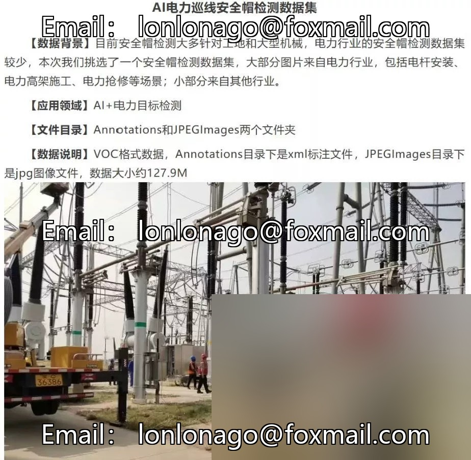
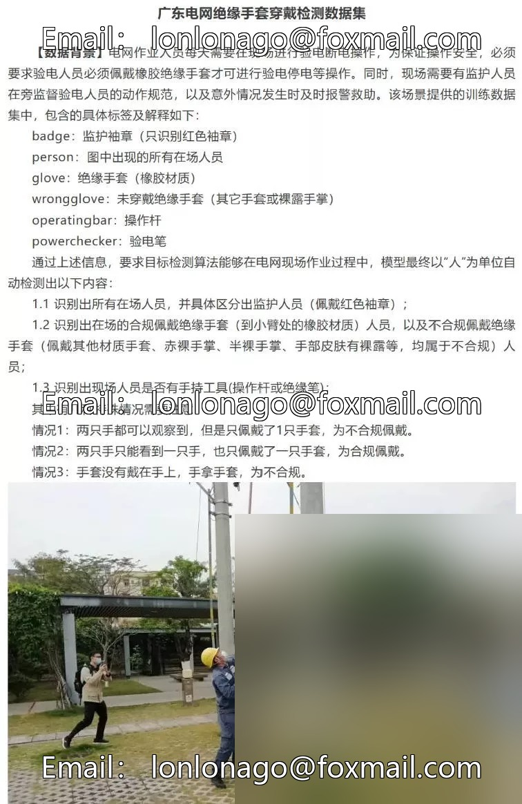
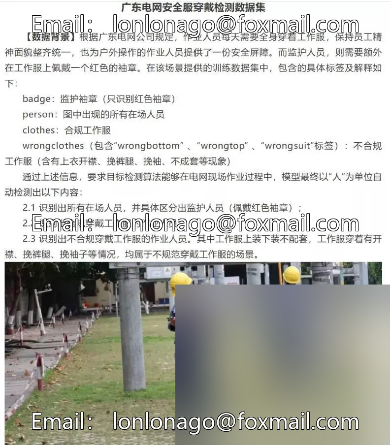
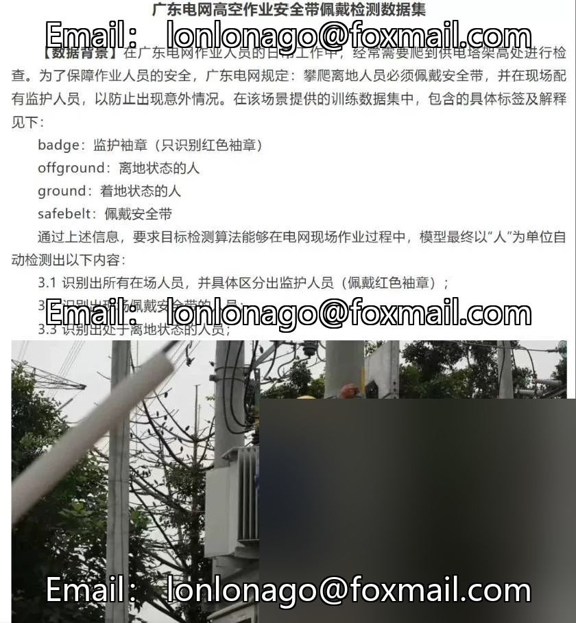

# Electricity grid operator protection and wearing compliance detection dataset

## Body

Power grid personnel protection and wear compliance detection dataset
Data includes:
1. Guangdong power grid insulating glove wearing detection dataset
2. Guangdong power grid safety garment wearing detection dataset
3. Guangdong power grid high altitude operation restraint wearing detection dataset
4. Power grid line patrol safety hat detection dataset

The price is one of the prices.

web-based shipment, can be directly photographed and shipped.

The dataset covers protection and wearing-compliance detection for grid workers, including multiple sub-datasets such as Guangdong Grid insulated gloves, safety gear, high-altitude work safety belts and electric line patrol safety caps; it includes scene and annotation rules, data formats and size information.

<!-- AI_ENRICHED -->

## Images

## Payment

Here is a pay link on Stripe ( https://buy.stripe.com/3cs8yP7sY87d0vu9AB ). Please contact me lonlonago@foxmail.com after funding $89, and I will send you a complete data files , thank you!

